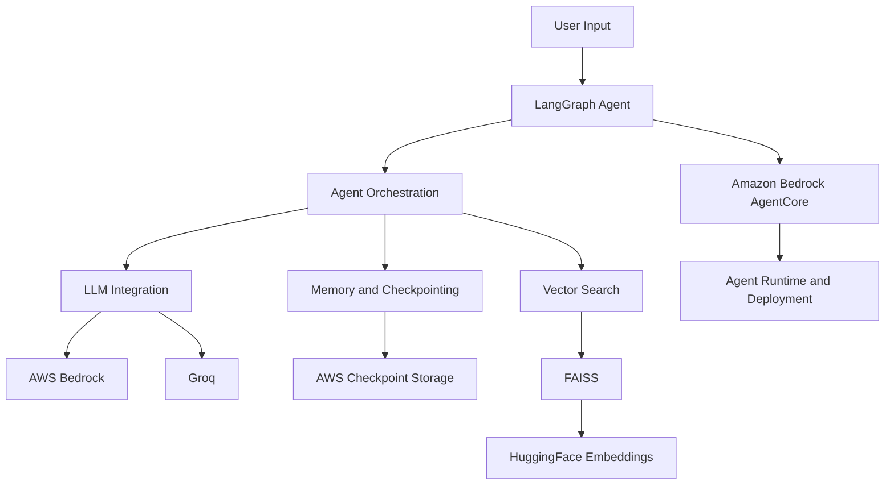

# 🚀 Amazon Bedrock AgentCore – Hands-On Crash Course

**Build, Orchestrate, Deploy, and Scale AI Agents with AWS, LangGraph, and LangChain**

A practical, hands-on crash course demonstrating how to build production-oriented AI agents using **Amazon Bedrock AgentCore, LangGraph, and LangChain**.

This repository provides step-by-step examples and notebooks covering agent development, orchestration, deployment, persistent memory, checkpointing, vector search, and integration with multiple Large Language Model (LLM) providers.

The goal is to understand how individual AI agent components work together to build scalable, stateful, and deployable AI agent applications.

---

## 🎯 Project Objectives

This project demonstrates how to:

- Build intelligent AI agents using LangGraph.
- Orchestrate agent workflows with LangChain and LangGraph.
- Deploy AI agents using Amazon Bedrock AgentCore.
- Implement persistent agent state and checkpointing on AWS.
- Integrate vector similarity search using FAISS.
- Generate embeddings using HuggingFace and Sentence Transformers.
- Connect multiple LLM providers, including AWS Bedrock and Groq.
- Understand the fundamentals of deploying AI agents in a cloud environment.

---

## 🏗️ Architecture Overview

The project brings together multiple components to demonstrate an end-to-end AI agent development workflow.



### Architecture Components

| Component | Responsibility |
|---|---|
| LangGraph | Agent workflow orchestration and state management |
| LangChain | LLM integration and agent development |
| Amazon Bedrock AgentCore | Agent runtime and deployment |
| AWS Checkpointing | Persistent agent state and conversation recovery |
| FAISS | Local vector similarity search |
| HuggingFace | Embedding model integration |
| Sentence Transformers | Text embedding generation |
| AWS Bedrock | Managed foundation model access |
| Groq | Alternative LLM provider |

---

## 🛠️ Technology Stack

| Technology | Purpose |
|---|---|
| Python 3.13+ | Primary development language |
| uv | Python package and environment management |
| bedrock-agentcore | Amazon Bedrock AgentCore runtime |
| bedrock-agentcore-starter-toolkit | Agent scaffolding and deployment tooling |
| langgraph | Agent orchestration and state graphs |
| langgraph-checkpoint-aws | AWS-based persistent checkpointing |
| langchain[aws] | AWS Bedrock integration |
| langchain-community | Community integrations |
| langchain-groq | Groq LLM integration |
| langchain-huggingface | HuggingFace integration |
| faiss-cpu | Local vector similarity search |
| sentence-transformers | Embedding generation |

---

## 📋 Prerequisites

Before starting, ensure you have the following:

### Software Requirements

- Python 3.13 or later.
- Git.
- Visual Studio Code or Cursor IDE.
- Windows PowerShell.
- uv package manager.

### Cloud and API Requirements

- AWS account.
- AWS credentials with appropriate IAM permissions.
- Access to Amazon Bedrock foundation models in your selected AWS region.
- Amazon Bedrock AgentCore access and required deployment permissions.
- Groq API key (optional, for Groq examples).

---

## ⚙️ Installation and Setup

### Step 1: Install uv

Install the uv package manager using Windows PowerShell.

```powershell
powershell -ExecutionPolicy ByPass -c "irm https://astral.sh/uv/install.ps1 | iex"
```

Verify the installation:

```powershell
uv --version
```

### Step 2: Clone the Repository

```powershell
git clone https://github.com/<YOUR_GITHUB_USERNAME>/agentcore-crash-course.git
```

Navigate to the project directory:

```powershell
cd agentcore-crash-course
```

### Step 3: Install Dependencies

Install all project dependencies:

```powershell
uv sync
```

This command automatically creates and manages the project's virtual environment (`.venv`) and installs the dependencies defined in `pyproject.toml`.

### Step 4: Configure Environment Variables

Create your local environment configuration file:

```powershell
Copy-Item .env.example .env
```

Open `.env` and configure your credentials.

**Environment Configuration**

```dotenv
# AWS Configuration
AWS_ACCESS_KEY_ID=your_access_key_id
AWS_SECRET_ACCESS_KEY=your_secret_access_key
AWS_REGION=us-east-1

# Groq Configuration (Optional)
GROQ_API_KEY=your_groq_api_key
```

**Important:** Use secure AWS authentication methods such as IAM roles or AWS IAM Identity Center where appropriate. Never commit actual credentials to GitHub.

### Step 5: Run Your First Agent

Execute the LangGraph agent example:

```powershell
uv run python 00_langgraph_agent.py
```

Always use `uv run` to ensure the script executes inside the project's managed virtual environment.

**Alternative: Activate the Virtual Environment**

```powershell
.venv\Scripts\Activate.ps1
```

Then execute:

```powershell
python 00_langgraph_agent.py
```

---

## 📁 Project Structure

```text
agentcore-crash-course/
│
├── 00_langgraph_agent.py
│   └── Entry-point example: Building a LangGraph agent
│
├── pyproject.toml
│   └── Project metadata and dependencies
│
├── uv.lock
│   └── Dependency lock file generated by uv
│
├── .env.example
│   └── Environment variable template
│
├── .env
│   └── Local credentials (not committed to Git)
│
├── .gitignore
│   └── Excludes sensitive files and generated artifacts
│
├── README.md
│   └── Project documentation
│
└── .venv/
    └── Python virtual environment (not committed to Git)
```

**Note:** Update this structure as additional scripts, notebooks, and modules are added to the repository.

---

## 🔐 Security Best Practices

This project follows a strict **No Secrets in Git** policy.

1. Never commit `.env` files.
2. Store only placeholder values in `.env.example`.
3. Add `.env` and `.venv/` to `.gitignore`.
4. Use AWS IAM roles or temporary credentials whenever possible.
5. Apply least-privilege IAM permissions.
6. Never expose AWS access keys or Groq API keys in source code, notebooks, screenshots, or logs.
7. If credentials are exposed, revoke and rotate them immediately.

### Recommended `.gitignore`

```gitignore
# Environment variables
.env
.env.*

!.env.example

# Virtual environments
.venv/
venv/

# Python cache
__pycache__/
*.py[cod]

# Jupyter
.ipynb_checkpoints/

# IDE
.vscode/
.idea/

# Logs
*.log

# OS files
.DS_Store
Thumbs.db
```

---

## 🧪 Troubleshooting

### 1. FAISS Installation Failure on Windows

`faiss-cpu` wheel availability depends on the Python version, operating system, and package release.

**Solution:**

- Verify that your selected FAISS version supports your Python version and Windows architecture.
- Check available wheels on PyPI.
- Review the dependency constraints in `pyproject.toml`.
- Consider using WSL2 or Linux if a compatible Windows wheel is unavailable.

### 2. ModuleNotFoundError

**Possible cause:** The script is being executed using system Python instead of the project's virtual environment.

**Solution:**

```powershell
uv sync
uv run python 00_langgraph_agent.py
```

### 3. AWS Bedrock Access Issues

Check the following:

- AWS credentials are correctly configured.
- The selected AWS region supports the required services and models.
- Required Bedrock model access has been enabled.
- IAM permissions are sufficient.
- AgentCore deployment permissions and prerequisites are configured.

### 4. Groq API Authentication Failure

Verify that:

- `GROQ_API_KEY` is correctly configured.
- The API key is valid.
- The environment configuration is loaded by the application.

---

## 📚 Learning Path

The repository is designed as a hands-on learning journey.

| Stage | Learning Area | Key Outcome |
|---|---|---|
| 01 | LangGraph Fundamentals | Build your first AI agent |
| 02 | Agent Orchestration | Design stateful agent workflows |
| 03 | LLM Integration | Connect AWS Bedrock and Groq |
| 04 | Memory and Checkpointing | Persist agent state on AWS |
| 05 | Vector Search | Implement semantic search with FAISS |
| 06 | Embeddings | Generate embeddings using HuggingFace |
| 07 | AgentCore Runtime | Prepare and deploy agents |
| 08 | Cloud Deployment | Understand the agent deployment lifecycle |

---

## 🎓 Expected Learning Outcomes

After completing the examples, you should be able to:

- Understand the architecture of modern AI agents.
- Build stateful agents using LangGraph.
- Integrate LLMs from different providers.
- Implement memory and persistent checkpointing.
- Build semantic retrieval workflows using FAISS.
- Work with HuggingFace embedding models.
- Package and deploy agents using Amazon Bedrock AgentCore.
- Understand the components required for production-oriented agent applications.

---

## 🚀 Getting Started

Clone the repository, configure your environment, install dependencies, and start building your first AI agent.

```powershell
git clone https://github.com/<YOUR_GITHUB_USERNAME>/agentcore-crash-course.git

cd agentcore-crash-course

uv sync

uv run python 00_langgraph_agent.py
```

---

## 📌 Repository Information

**Project:** Amazon Bedrock AgentCore Crash Course

**Focus:** AI Agents | Agentic AI | AWS | LangGraph | LangChain

**Language:** Python

**Package Manager:** uv

**LLM Providers:** Amazon Bedrock and Groq

**Vector Database:** FAISS

**Deployment Platform:** Amazon Bedrock AgentCore

---

## ⭐ Support

If you find this repository useful for learning AI agents and AWS-based agent development, consider giving it a ⭐ on GitHub.

Feel free to fork the repository, experiment with the examples, and contribute improvements.

**Happy Building! 🚀**